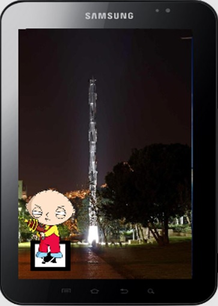

# AR / 3D Skype to Android

<p align="center">
  
</p>

*Original project image, unchanged.*

This project explored sending Kinect depth data to an Android tablet and placing the reconstructed content in the tablet's camera view, anchored to a tracked marker.

Students: Raafat Francis, Hashem Naara. Supervision: Aaron Wetzler.


## Original

Only the project image and description survive. The application source, report and build configuration have not been recovered, so the original app cannot be built or run. The [recovery notes](docs/RECOVERY.md) record historical requirements, sources and attribution.

## Updated

[**Run the browser demo**](https://twerdster.github.io/android-3d-skype/)

A separate browser demo, written in November 2026, illustrates the idea with generated data. You can sample a synthetic depth surface, rotate the resulting point cloud, drag a marker anchor into place and export the frame. It uses no Kinect stream or camera, does not track a marker and does not reproduce the historical app. The recovered original files are unchanged.

### Run locally

```sh
python3 -m http.server 8000 --directory docs
```

Then open http://localhost:8000. No build step or external service is required.

### Checks and licensing

Browser-check results, implementation notes and limits are in [updated/README.md](updated/README.md). These checks apply only to the new demo; they do not validate the historical application or any hardware. The [MIT license](docs/DEMO-LICENSE.txt) covers only the new demo; original materials keep their existing attribution and terms.
