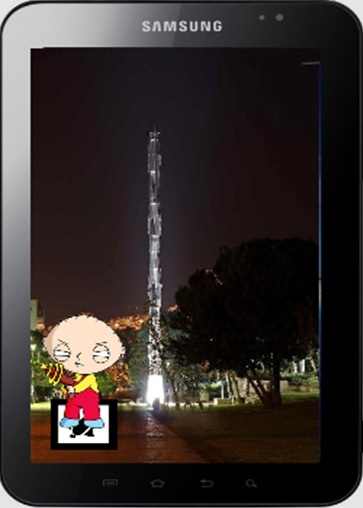

# AR / 3D Skype to Android

  

Real-time Kinect depth streaming to an Android tablet, with Vuforia marker tracking to place the reconstructed scene in augmented reality.

Students: Raafat Francis, Hashem Naara.

Supervision: Aaron Wetzler.

## Status

**Coming soon.** This repository is being prepared as a historical student-project archive. Original source code, project documents and build instructions will be added as they are recovered and reviewed. It is not yet a runnable release.

## Original code

Original application source has not been located for this archive yet. This does not mean the code no longer exists; it will be added under `source/` only after it is recovered and reviewed.

## Running

No runnable source has been published in this repository yet. Platform requirements and setup instructions will be recorded from the original project files rather than guessed.

## Links

- [Project entry on Aaron Wetzler's website](https://twerdster.github.io/#ar-3d-skype-to-android)

## Attribution and Updates

Original student and third-party attribution will be retained. No license for unrecovered source code is implied by this README. Original authors can open an issue to contribute updates or request corrections or removal of their material.

Figure provenance: `assets/project-preview.jpg` is the original student-project image from the archived project page on Aaron Wetzler's website, copied without modification. Any third-party characters shown remain the property of their owners.
